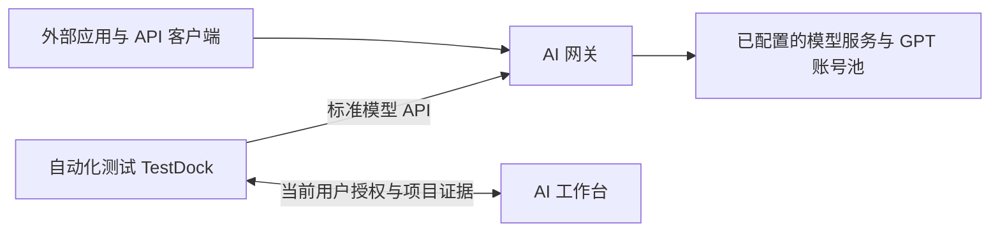

# 深蓝智能 · ShenLanAgent

深蓝智能体及 AI 中转站、工作站、自动化测试平台等子模块。

将模型接入、知识协作和自动化测试放在同一项目中管理。三个模块各自提供 Web/API、配置、数据和部署方式，通过授权接口协作。

## 模块导航

| 模块 | 作用 | 源码与使用说明 | 运维文档 |
| --- | --- | --- | --- |
| **AI 网关 · AI Gateway** | 模型 API、应用 Key、路由、额度、钱包、托管会话与请求审计 | [进入模块](modules/ai-gateway/README.md) | [部署与维护](modules/ai-gateway/docs/运行与维护.md) |
| **AI 工作台 · AI Workbench** | 本地文档与 OCR、混合检索、项目知识、会话和记忆、按权限与测试平台联动 | [进入模块](modules/ai-workbench/README.md) | [部署与维护](modules/ai-workbench/docs/运行与维护.md) |
| **自动化测试 · TestDock** | Web/API 用例、多环境执行、Cron/CI、报告、通知与站内 AI 助手 | [进入模块](modules/autotest-platform/README.md) | [部署与维护](modules/autotest-platform/docs/运行与维护.md) |

## 模块协作



模型调用需单独配置供应商或账号池，并在各模块配置授权。模块间通过 API 交换数据，权限校验与持久化由各模块负责。功能范围与实际验收状态见各模块文档。

## 仓库结构

```text
deepblue-intelligence/
├── README.md                 # 深蓝智能总览与模块入口
├── AGENTS.md                 # 汇总仓库维护规则
├── source-manifest.json      # 来源版本、Git 基线与逐文件 SHA-256
├── docs/                     # 总体计划、运维与路径说明
├── scripts/                  # 汇总仓库专用检查脚本
└── modules/
    ├── ai-gateway/           # AI 网关
    ├── ai-workbench/         # AI 工作台
    └── autotest-platform/    # TestDock 自动化测试平台
```

## 从哪里开始

1. 在上方表格进入所需模块，先阅读该模块的 README 和运行与维护文档。
2. 使用 Python 3.12 或更新版本；按各模块的 requirements.lock 建立独立环境。
3. 各模块分别配置服务路径、端口、密钥和数据库；本机运行约定见[环境与存储说明](docs/虚拟机目录与存储规范.md)。
4. 配置模型能力和模块间授权后，再验证需要的联动流程。

现有文档中的 /home/nanshan/workspace/projects/<模块名> 是原部署源码位置。modules/ 用于源码汇总与导航；在另一台机器部署时，按各模块文档核对路径与配置。总仓库本身不启动业务服务。

## 部署与迁移

- [迁移总手册](docs/迁移总手册.md)：整机迁移、新机重建、依赖、私密数据恢复与上线验收。
- [代理、SSH与花生壳](docs/代理与网络迁移.md)：旧Mac代理迁至Windows、端口、账号池、设备绑定及外网验证。
- [原机配置清单](infra/migration/README.md)：systemd单元、去敏配置、软件版本、安装包/模型哈希。

## 来源与维护

本次导入保留三个项目当前工作树，来源 Git 基线、未提交状态、版本和文件校验记录见 [source-manifest.json](source-manifest.json)。原有验收记录保留于模块内，表示相应版本当时执行的检查。

仓库包含源码、文档、测试、配置示例、依赖锁文件及第三方声明。真实配置、密钥、账号授权、数据库、运行附件、日志、依赖目录和本地模型缓存由各部署环境独立维护。

- [项目开发计划](docs/开发计划书.md)
- [汇总与发布维护](docs/运行与维护.md)
- [本地内容校验](scripts/verify_bundle.py)

第三方组件与参考依据：[AI 网关项目研究](modules/ai-gateway/docs/GitHub项目研究.md)、[AI 工作台](modules/ai-workbench/THIRD_PARTY.md)、[TestDock](modules/autotest-platform/THIRD_PARTY.md)。

历史验收文档中部分链接指向原工作区的运行报告、截图和测试证据，这些运行资料不包含在源码仓库中。第三方许可文本按来源原样保留，其中的上游相对链接可能不包含目标文件。
